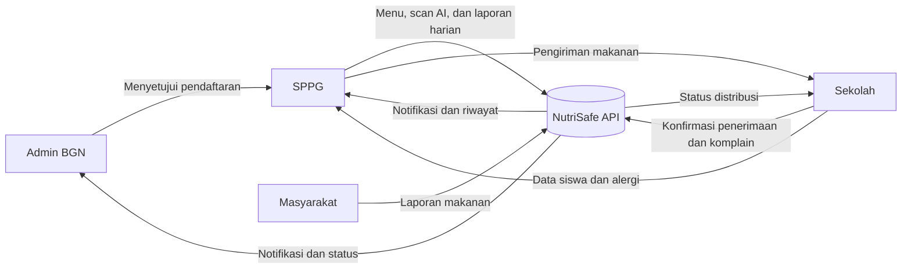

# NutriSafe Mitra

> **Platform pemantauan keamanan pangan dan distribusi makanan bergizi untuk ekosistem Program Makan Bergizi Gratis (MBG).**

NutriSafe membantu Satuan Pelayanan Pemenuhan Gizi (SPPG), sekolah, pengelola program, dan masyarakat bekerja dalam satu alur yang terhubung. Aplikasi **NutriSafe Mitra** pada repository ini berfokus pada operasional SPPG: mengelola sekolah binaan, memindai menu dengan bantuan AI, memantau alergi siswa, mengirim laporan, dan menindaklanjuti masalah makanan.

- Backend produksi: [`https://api.nutrisafe.id`](https://api.nutrisafe.id)
- Dokumentasi API: [NutriSafe API — Semua Role](https://documenter.getpostman.com/view/28796164/2sBYHSwzid)

---

## Mengapa NutriSafe?

Distribusi makanan dalam skala besar bukan hanya persoalan jumlah porsi. Setiap menu perlu aman, sesuai kebutuhan gizi, terdokumentasi, dan dapat ditelusuri ketika terjadi masalah. Data alergi siswa juga harus sampai kepada pihak yang menyiapkan makanan sebelum menu dikirim.

NutriSafe menjawab kebutuhan tersebut melalui:

- deteksi bahan dan estimasi nutrisi berbasis foto;
- perbandingan data gizi SPPG dengan hasil analisis AI;
- pemantauan alergi siswa pada setiap sekolah binaan;
- pencatatan menu serta pengiriman makanan secara terstruktur;
- jalur pelaporan masalah dan komplain yang dapat ditelusuri;
- notifikasi lintas role untuk mempercepat tindak lanjut.

## Aplikasi dalam repository ini

Repository ini berisi aplikasi Flutter **NutriSafe Mitra**, yaitu aplikasi untuk role **SPPG/Mitra**. UI Admin BGN, Sekolah, dan Masyarakat merupakan bagian dari ekosistem NutriSafe yang berkomunikasi melalui backend yang sama, tetapi tidak diimplementasikan di repository ini.

## Fitur utama NutriSafe Mitra

### 1. Autentikasi dan profil SPPG

- Login khusus akun berdomain `@sppg.id`.
- Penyimpanan token secara aman menggunakan secure storage.
- Melihat dan memperbarui profil SPPG.
- Melihat status persetujuan kemitraan dan kapasitas produksi.
- Perubahan serta pemulihan kata sandi.

### 2. Pengelolaan sekolah binaan

- Melihat sekolah yang belum memiliki mitra.
- Menghubungkan sekolah dengan SPPG.
- Melihat sekolah binaan beserta jumlah siswa, guru, dan jenis alergi.

### 3. Monitoring alergi siswa

- Ringkasan sekolah binaan dan data alergi.
- Distribusi jenis alergi di seluruh sekolah.
- Jumlah kejadian alergi per sekolah sebagai bahan perencanaan menu.

### 4. Scan dan analisis menu berbasis AI

- Mengunggah atau mengambil foto menu makanan.
- Mengirim foto dan jumlah porsi ke endpoint analisis.
- Menampilkan bahan yang terdeteksi.
- Menampilkan peringatan alergi dan status gizi.
- Membandingkan input nutrisi SPPG dengan estimasi AI per porsi.
- Menampilkan total nutrisi yang terdeteksi pada foto.
- Mendukung rekomendasi menu pengganti ketika layanan rekomendasi backend aktif.

### 5. Pelaporan menu harian

- Memastikan satu laporan menu untuk setiap SPPG per hari.
- Mengirim nutrisi total, jumlah porsi, bahan terdeteksi, referensi foto, dan hasil rekomendasi.
- Memeriksa status laporan hari ini sebelum pengguna mengirim ulang.

### 6. Riwayat dan detail pengiriman

- Filter riwayat berdasarkan bulan dan tahun.
- Informasi sekolah tujuan, jumlah porsi, status, serta persentase distribusi.
- Rincian menu, kebutuhan substitusi alergi, dan dokumentasi foto.
- Tampilan responsif hingga layar 320 px dan pembesaran teks 2×.

### 7. Laporan makanan bermasalah

- Menerima komplain dari Sekolah/Masyarakat.
- Menampilkan jenis masalah, makanan, sekolah, porsi terdampak, status, dan foto bukti.
- Mendukung pengiriman laporan masalah internal SPPG melalui API.

### 8. Notifikasi berbasis API

- Daftar notifikasi pengguna yang sedang login.
- Jumlah notifikasi belum dibaca.
- Tandai satu atau seluruh notifikasi sebagai dibaca.
- Pull-to-refresh, loading state, error state, dan empty state.

## Role dalam ekosistem NutriSafe

| Role | Tanggung jawab utama |
|---|---|
| **Admin BGN** | Memverifikasi pendaftaran SPPG, mengawasi kemitraan, dan memantau operasional program. |
| **SPPG / Mitra** | Menyiapkan menu, memperhatikan data alergi, mencatat nutrisi, dan mengirim makanan ke sekolah. |
| **Sekolah** | Mengelola data siswa dan alergi, menerima distribusi, serta melaporkan kondisi makanan. |
| **Masyarakat / Umum** | Memantau informasi yang tersedia dan menyampaikan laporan makanan melalui kanal publik. |

## Alur masing-masing role

### Admin BGN

1. Admin login ke sistem.
2. Admin meninjau pendaftaran SPPG beserta dokumen proposal dan foto dapur.
3. Admin menyetujui atau menolak pendaftaran.
4. Setelah disetujui, akun login SPPG dibuat dan kredensial dikirim kepada PIC.
5. Admin memantau status kemitraan dan aktivitas program melalui dashboard pengelola.

### SPPG / Mitra

1. PIC mendaftarkan SPPG dan menunggu persetujuan Admin BGN.
2. Setelah memperoleh akun, petugas login ke NutriSafe Mitra.
3. SPPG memilih dan menghubungkan sekolah binaan.
4. Petugas memeriksa data siswa serta alergi dari sekolah binaan.
5. Petugas mengisi data menu, jumlah porsi, dan informasi gizi per porsi.
6. Foto menu dikirim untuk dianalisis oleh AI.
7. SPPG membandingkan input internal dengan hasil deteksi bahan dan nutrisi AI.
8. Jika aman, laporan menu harian dikirim dan disimpan.
9. Makanan dikirim ke sekolah disertai laporan pengiriman dan dokumentasi.
10. SPPG memantau penerimaan, komplain sekolah, masalah makanan, dan notifikasi.

### Sekolah

1. Sekolah mendaftarkan akun dan melengkapi profil sekolah.
2. Sekolah mencatat data siswa, termasuk kebutuhan dan jenis alergi.
3. Data alergi tersedia bagi SPPG yang menjadi mitra sekolah.
4. Sekolah menerima notifikasi ketika makanan sedang dikirim.
5. Petugas sekolah mengonfirmasi penerimaan dan jumlah porsi.
6. Jika ditemukan masalah—misalnya makanan basi, kekurangan porsi, keterlambatan, atau risiko alergen—sekolah mengirim laporan.
7. Laporan tersebut muncul pada aplikasi SPPG untuk ditindaklanjuti.

### Masyarakat / Umum

1. Pengguna mengakses kanal umum NutriSafe.
2. Pengguna melihat informasi program yang tersedia.
3. Jika menemukan masalah makanan, pengguna mengirim laporan beserta deskripsi dan bukti.
4. Laporan diteruskan kepada pihak yang relevan melalui backend NutriSafe.

## Alur data utama



## Teknologi

### Mobile application

| Teknologi | Kegunaan |
|---|---|
| **Flutter & Dart** | Aplikasi lintas platform Android, iOS, dan Web. |
| **Material 3** | Sistem desain dan komponen antarmuka responsif. |
| **flutter_bloc** | Pengelolaan state autentikasi dan sesi. |
| **go_router** | Navigasi deklaratif, protected route, dan shell navigation. |
| **Dio** | HTTP client, multipart upload, interceptor autentikasi, dan timeout. |
| **get_it** | Dependency injection dan lifecycle repository. |
| **flutter_secure_storage** | Penyimpanan token autentikasi secara aman. |
| **image_picker & file_selector** | Pengambilan foto dan pemilihan dokumen. |
| **flutter_svg** | Rendering aset ikon SVG. |

### Backend dan layanan terintegrasi

- REST API produksi di `https://api.nutrisafe.id`.
- Backend menggunakan Go dan Fiber.
- JWT Bearer Authentication.
- Multipart upload untuk foto dan dokumentasi.
- Analisis foto menu berbasis AI/Gemini pada layanan backend.

## Arsitektur aplikasi

```text
lib/
├── app/
│   ├── di/                 # Registrasi dependency
│   ├── router/             # Routing dan proteksi sesi
│   └── theme/              # Tema aplikasi
├── core/
│   ├── error/              # Normalisasi kegagalan
│   ├── network/            # Dio, konfigurasi API, interceptor
│   ├── storage/            # Secure token storage
│   └── widgets/            # Komponen bersama
└── features/
    ├── allergy_monitoring/
    ├── auth/
    ├── food_issues/
    ├── food_report/
    ├── food_scan/
    ├── notifications/
    ├── partnership/
    ├── profile/
    └── schools/
```

Setiap fitur memisahkan lapisan data, domain bila diperlukan, dan presentation. Repository menerima `Dio` melalui constructor injection; UI tidak mengakses service locator secara langsung.

## Endpoint yang digunakan aplikasi Mitra

```text
POST   /login
GET    /sppg/profile
PUT    /sppg/profile
GET    /sppg/status
GET    /sppg/available-schools
POST   /sppg/assign-schools
GET    /sppg/schools
GET    /sppg/allergy-dashboard
POST   /sppg/scan
POST   /sppg/scan/recommend
POST   /sppg/menu-reports
GET    /sppg/menu-reports/today
GET    /sppg/delivery-reports
GET    /sppg/delivery-reports/:id
POST   /sppg/delivery-reports
POST   /sppg/food-problems
GET    /sppg/food-reports
GET    /notifications
GET    /notifications/unread-count
PATCH  /notifications/:id/read
PATCH  /notifications/read-all
```

## Menjalankan proyek

### Prasyarat

- Flutter SDK yang kompatibel dengan Dart `^3.13.4`.
- Android Studio/Android SDK untuk target Android.
- Perangkat atau emulator dengan koneksi internet.

### Instalasi

```bash
git clone https://github.com/AkbarFelda/nutrisafe_mitra.git
cd nutrisafe_mitra
flutter pub get
flutter run
```

Secara default aplikasi menggunakan API produksi `https://api.nutrisafe.id`.

Untuk memakai backend lain:

```bash
flutter run --dart-define=API_BASE_URL=https://alamat-backend.example
```

Mock API hanya aktif jika diminta secara eksplisit:

```bash
flutter run --dart-define=USE_MOCK_API=true
```

## Build APK

```bash
flutter build apk --release
```

Hasil build tersedia di `build/app/outputs/flutter-apk/app-release.apk`.

## Pengujian dan kualitas

```bash
flutter analyze
flutter test
```

Pengujian mencakup autentikasi, sesi, repository API, parsing respons aktual, navigasi, scanner, riwayat dan detail pengiriman, laporan bermasalah, monitoring alergi, notifikasi, serta layout responsif pada berbagai ukuran layar dan pembesaran teks.

## Keamanan

- Token disimpan menggunakan native secure storage.
- Authorization header hanya dikirim ke origin API yang telah dikonfigurasi.
- Request publik tidak membawa bearer token.
- Respons `401` menghapus sesi yang sesuai tanpa merusak sesi login yang lebih baru.
- Kredensial dan secret tidak disimpan di source code.
- Backup aplikasi Android dinonaktifkan untuk mengurangi risiko kebocoran token.

## Catatan implementasi

- Endpoint rekomendasi menu dapat membalas `503` ketika fitur ML belum diaktifkan oleh backend; aplikasi menampilkannya sebagai fitur yang belum tersedia, bukan kegagalan scan.
- Komplain dari sekolah pada `/sppg/food-reports` berbeda dari laporan menu harian pada `/sppg/menu-reports`.
- Data nutrisi pada `menu_detail` merupakan total seluruh porsi, sedangkan `kalori_per_porsi` dikirim terpisah oleh backend.

---

<div align="center">
  <strong>NutriSafe — makanan bergizi, aman, terdokumentasi, dan dapat ditelusuri.</strong>
</div>
